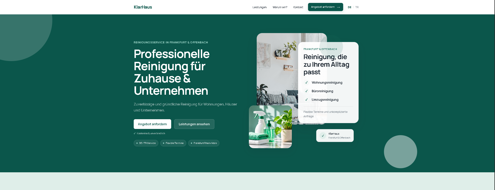

# KlarHaus Cleaning

A modern, responsive bilingual website concept for a fictional cleaning service operating in Frankfurt and the Rhein-Main area.

KlarHaus was created as a portfolio project to demonstrate the design and development of a professional small-business website with a strong focus on usability, responsive design and conversion-oriented structure.

## Live Demo

[View the live project](https://klarhaus-cleaning.vercel.app/)



## Features

- Responsive desktop, tablet and mobile layout
- German and Turkish language support
- Persistent language selection with LocalStorage
- Modern service presentation
- Interactive mobile navigation
- Service-area map for the Rhein-Main region
- Quote request form
- Accessible navigation and form feedback
- Responsive service cards and testimonial sections
- Production-ready Vite build

## Technologies

- React
- JavaScript
- Vite
- CSS Modules
- HTML5
- Responsive CSS
- LocalStorage

## Project Structure

```text
src/
├── assets/
├── components/
├── locales/
├── sections/
├── styles/
├── App.jsx
├── index.css
└── main.jsx
```
